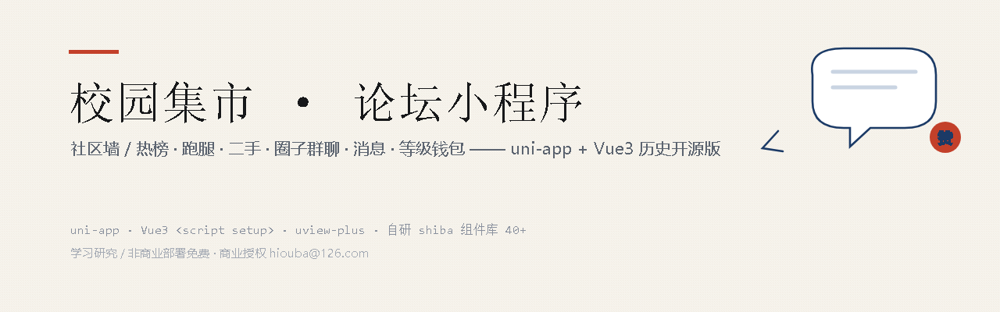
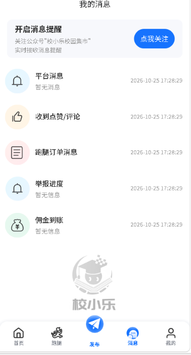
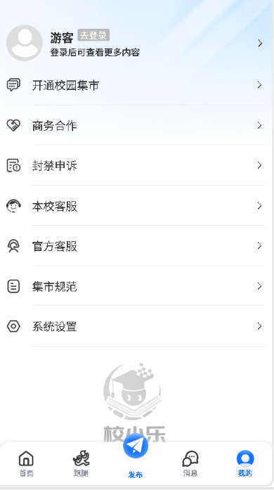

# 校小乐校园集市（开源历史版）



> 校园集市小程序 · uni-app + Vue3 + uview-plus · 开源历史版本（v1.x）
>
> 版权所有 (c) 2026 北京煜澜文化（beijingyulanwenhua）· 校小乐（xiaoxiaole）

这是一个面向高校的校园集市小程序，集**社区墙（帖子/评论/点赞）、跑腿任务、二手市场、圈子群聊、钱包提现、消息中心**于一体的多角色（用户/管理员/跑腿员）应用。

本仓库为**早期历史版本**，仅用于学习交流与非商业部署；当前线上商用版本功能更完善，不在本仓库范围内。使用前请阅读 [LICENSE](LICENSE.md)。

## 功能特性

| 模块 | 说明 |
| --- | --- |
| 社区墙 | 发帖、评论、回复、点赞、今日热榜、每日一乐 |
| 跑腿 | 发布任务、接单工作站、实名认证、订单跟踪、保证金/提现流程 |
| 圈子 | 创建/加入圈子、圈子群聊、圈子动态 |
| 二手 | 二手发布、求购、分类浏览 |
| 钱包 | 余额、保证金、提现申请与记录 |
| 消息中心 | 平台公告、互动通知、系统消息 |
| 个人中心 | 等级体系、头像/性别/认证标识、地址管理、反馈、协议 |

## 界面预览

| 首页（金刚区+信息流） | 社区墙消息中心 |
| --- | --- |
|  |  |

| 跑腿接单大厅 | 个人中心 |
| --- | --- |
|  |  |

> 截图中的学校名称、用户昵称与帖子内容已做脱敏处理。

## 技术栈

- **框架**：uni-app（Vue3 `<script setup>`）+ Vite
- **UI**：uview-plus 3.x + 自研 `shiba` 组件库（40+ 组件）
- **状态/路由**：Pinia（shiba/store）+ 自研路由拦截与权限（shiba/route、shiba/permissions）
- **网络**：自研 request 封装（shiba/api），Token 自动注入、统一错误处理
- **运行环境**：HBuilderX（推荐）或 uni-app CLI；目标端：微信小程序 / H5

## 快速开始

### 1. 环境准备

- [HBuilderX](https://www.dcloud.io/hbuilderx.html)（推荐，直接打开即可运行）
- 或 Node.js 18+，全局安装 uni-app CLI 工具链
- 微信开发者工具（真机调试小程序端）

### 2. 配置后端

本仓库为**纯前端**开源，后端接口不在本仓库内。启动前需准备可用的后端服务：

1. 复制 `.env.development` / `.env.production`，将 `VUE_APP_API_URL` 改为你的后端地址：

   ```env
   VUE_APP_API_URL=https://api.example.com/
   VUE_APP_APIFiX_URL=/api
   ```

2. 用你自己的后端实现 `/api/...` 下对应接口（用户登录、帖子、跑腿、钱包等）。

### 3. 配置小程序 AppID

打开 `manifest.json`，将 `mp-weixin.appid` 替换为你自己的小程序 AppID（当前为占位符 `__UNI__XXXXXX`）。

### 4. 运行

**⚠️ 首次运行前必须先安装依赖**（否则报 `Could not resolve "uview-plus"`）：

```bash
npm install
```

本工程是 **HBuilderX 项目（uni-app + vite）**，编译器内置于 HBuilderX，**不需要**在 node_modules 安装 vite / @dcloudio/vite-plugin-uni（该包的公网版本与 HBuilderX 版本严格对应，公网大多版本不可下载，勿手动添加）。

- **HBuilderX 运行**：打开本目录 → 「运行 → 运行到小程序 → 微信开发者工具」
- **运行到小程序无反应的排查**（按概率排序）：
  1. **微信开发者工具未打开或未开启服务端口**：打开微信开发者工具 → 右上角「设置 → 安全设置」→ 勾选「开启服务端口」（HBuilderX 靠它调起开发者工具）
  2. **HBuilderX 未配对开发者工具路径**：HBuilderX「工具 → 选项 → 运行」→ 检查「微信开发者工具安装路径」是否指向你的实际安装目录
  3. 从菜单「运行 → 运行到小程序 → 微信开发者工具」进入，不要点工具栏默认的「运行」按钮（默认目标可能是浏览器）
  4. 以上无效：关闭 HBuilderX 和微信开发者工具，先开微信工具（开服务端口），再开 HBuilderX 运行

## 常见编译提示（均可忽略）

- `Browserslist: browsers data (caniuse-lite) is 12 months old`：浏览器数据旧提示，不影响编译；想消除可执行 `npx update-browserslist-db@latest`
- `defineProps is a compiler macro and no longer needs to be imported`：Vue3 编译器提示，不影响构建

## 目录结构

```
├── pages/            # 业务页面（index 社区墙 / errand 跑腿 / public 公共页 / my 我的 …）
├── shiba/            # 自研组件库与基建（components / api / store / route / rules / hooks）
├── components/       # 页面级公共组件
├── static/           # 静态资源（图标、默认头像、等级图片）
├── uni_modules/      # 第三方 uni 组件（uview-plus / z-paging / uni-icons …）
├── App.vue           # 应用入口（启动逻辑）
├── main.js
├── manifest.json     # 应用清单（AppID、权限）
└── .env.*            # 环境变量（接口地址）
```

## 版权与授权

- 本软件采用 [校小乐社区许可证](LICENSE.md)（非商业免费，商用需授权）
- 源码中含版权水印锚点，**请勿移除**
- 商业授权联系：hiouba@126.com

## 免责声明

本项目按"现状"提供，仅供学习交流。使用本软件产生的一切后果由使用者自行承担。
